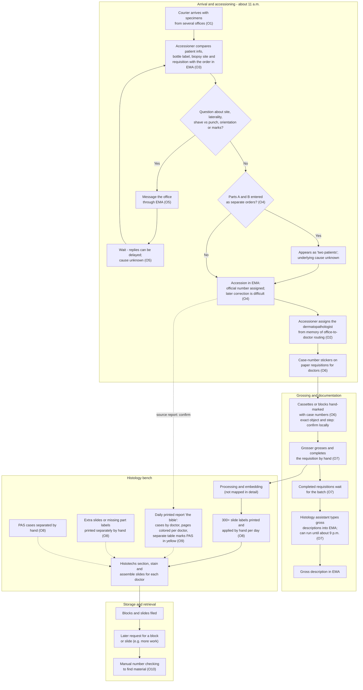

# Workflow Map: Before and Proposed After

This map compares the current workflow, **as Jorge has observed it**, with a **proposed** workflow using Histology Lab OS as a companion to EMA.

How to read it:

- **O1–O12** refer to the employee observations listed in `product-brief.md` (Section 2.1). They are observations, not audited findings or measured rates.
- **"Confirm locally"** marks steps whose exact object, order or owner has not been verified.
- **H1–H12** are hypotheses. **Every benefit shown in the "after" map is a hypothesis to measure**, not a demonstrated result. Section 5 lists how each one would be measured.
- Processing, embedding, sectioning and staining are shown only at the level needed to show handoffs; they were not mapped in detail.

---

## 1. BEFORE: current workflow (as observed)

Solid arrows are physical or sequential steps. Dotted arrows are information handoffs.

### Notes on the "before" map

- The order of stickers, cassette marking and routing is drawn as Jorge remembers it and should be **confirmed locally**.
- The physical work (grossing → processing) and the documentation work (requisition → batch → typing into EMA) run on **separate tracks**. The late-evening transcription (O7) is on the documentation track; what actually holds it back (grossing, documentation, transcription, staffing or processing cutoffs) is unknown and must be measured separately.
- Where the information in "the bible" comes from (which EMA report, who prints and colors it, when) should be confirmed.

### Observed in other settings (context only)

| Setting | Observed | Caution |
|---|---|---|
| Quest Diagnostics (O11) | Hourly Crystal Reports report of additional-work orders; manual retrieval sometimes of more than 100 blocks; printed requests sorted into a set order; delayed cases; long block searches; slides and paper requisitions scanned repeatedly while assembling trays | Crystal Reports is a reporting tool; it says nothing about the underlying LIS |
| UHealth (O12) | Spoken grossing communication with exact dimensions and piece counts | Hands-free capture may suit a grossing bench; the questions are identity linkage, verification, accuracy, integration and timing |

---

## 2. PROPOSED AFTER: with Histology Lab OS as a companion

```mermaid
flowchart TD
  C1["Courier arrives"] --> I1["Intake bench: scan or search;<br/>manifest shows expected vs received;<br/>expected = unknown if no manifest (H1)"]
  I1 --> V1["Comparison panel: order vs observed container<br/>vs requisition; staff confirm against<br/>the physical container (H1)"]
  V1 --> D1{"Related-order<br/>candidate found?"}
  D1 -->|Yes| RV1["Reviewer decides: link as related or<br/>keep separate; both source orders kept,<br/>never merged (H3)"]
  D1 -->|No| D2
  RV1 --> D2{"Discrepancy on a part?"}
  D2 -->|"Yes, affected part only"| CL1["Targeted clarification, e.g. CLR-0457:<br/>lab owner, office contact role, follow-up time;<br/>hold on the affected part only (H4, H5)"]
  CL1 --> CL2["Office answer - simulated in demo -<br/>reviewed by the lab owner, then resolved"]
  CL2 --> RT1
  D2 -->|"No, or unaffected parts"| RT1["Routing: approved, versioned office rule<br/>suggests the dermatopathologist and shows the rule;<br/>unknown office = routing exception (H2)"]
  RT1 --> ACC["Official accession issued in EMA<br/>(source simulator in demo)"]
  ACC --> PQ["Print queue linked to official IDs;<br/>timeouts = unknown outcome until reconciled;<br/>simulated printer (H9)"]
  ACC --> WL["Live worklist by doctor name and color;<br/>PAS as text with its order and<br/>affected block/slide (H7, H8)"]
  PQ -.-> G1
  G1["Grossing: open the exact case and part;<br/>structured fields plus narrative;<br/>confirm numbers, units and counts"] --> G2{"This part reviewed and<br/>approved for downstream use?"}
  G2 -->|Not yet| G1
  G2 -->|Yes| E1["Task: enter gross description in EMA;<br/>shown as entered only after<br/>EMA acknowledges (H6)"]
  G2 -->|Yes| CS["Cassette eligible for processing;<br/>other parts stay incomplete (H6)"]
  E1 --> EG1["Gross description in EMA"]
  CS --> WL
  WL --> HT["Histotech views: section and stain"]
  PQ -.-> HT
  HT --> TY["Tray: set tray and case once, then verify<br/>each slide; flag missing, unexpected,<br/>duplicate or canceled (H10)"]
  TY --> ST["Storage: record location;<br/>last confirmed slot and checkout"]
  ST --> RR["Retrieval request: pick list by location;<br/>scan must match the requested block (H11)"]
  OPS["Operations view: what is blocked,<br/>who owns the next step, evidence,<br/>data age (H12)"]
  CL1 -.-> OPS
  RT1 -.-> OPS
  G2 -.-> OPS
  TY -.-> OPS
  RR -.-> OPS

  classDef ema fill:#e6edf8,stroke:#2f5597,color:#14254a
  classDef review fill:#fff3dc,stroke:#a86b00,color:#3d2a00
  class ACC,EG1 ema
  class RV1,CL2,G2 review
```

Blue boxes stay in EMA (authoritative). Amber boxes are human review or decision points. Everything else is an operational task in the companion. Dotted arrows are information handoffs.

### Notes on the "after" map

- **Holds are scoped.** A discrepancy on Part B holds Part B, not the whole delivery or the whole case. Whether accessioning waits for a clarification is decided by **local policy**; the companion does not invent release rules.
- **Related orders are never merged.** The system shows reasons and conflicts for a candidate; a person decides. Two legitimate encounters for the same patient stay separate.
- **Gross records move per part.** "Approved for downstream use" in the companion is not the same as "entered in EMA." The EMA entry stays a separate, tracked task until EMA acknowledges it. Direct structured entry inside EMA may turn out to be the better first intervention (see `product-brief.md`, Section 5).
- **Paper does not disappear on day one.** The worklist offers a printable snapshot showing generation time and version, for downtime and transition.
- **Labels still need hands and hardware.** A web page cannot physically apply 300 stickers. Real printing depends on compatible printers, drivers, validated materials and bench procedures.
- **Location is "last confirmed," not live.** Scanning a location does not prove every item in it is present.

---

## 3. Handoff table

"Failure mode observed" says **Observed** only where Jorge saw it; otherwise it says so plainly.

| # | Handoff (who → who) | Information | Current medium | Failure mode observed | Proposed change (hypothesis) | What remains in EMA | What must be measured |
|---|---|---|---|---|---|---|---|
| 1 | Courier/office → accessioner | Which containers came from which office | Physical bags and paper requisitions; manifest unknown | Not specifically observed. Whether expected counts are known at arrival is unknown (O1) | Manifest view: expected vs received, missing/extra; "unknown" when there is no manifest (H1) | Orders | Containers expected vs received; missing/extra items; minutes to reconcile a delivery |
| 2 | Office order → accessioner | Patient identifiers, site, laterality, procedure, orientation/marks | EMA order, bottle label, paper requisition | **Observed:** questions about shave vs punch, orientation, marks, laterality, exact site (O3) | Side-by-side comparison; explicit "verified against physical container" (H1) | Patient record, order | Hands-on accession minutes per case; discrepancy counts by category, with volume denominator |
| 3 | Office → lab (multi-part) | Parts A and B from one collection | Separate EMA orders | **Observed:** shows up as "two patients"; correction after accession is difficult; cause unknown (O4) | Related-order candidate with reasons and conflicts; reviewer decides; no merge (H3) | Orders, accession, any official correction | How often; found before vs after accession; post-accession correction requests |
| 4 | Accessioner ↔ office (clarification) | Question and answer about a specific part | EMA message | **Observed:** delayed responses; cause unknown (O5) | Clarification task with owner, office contact role, follow-up time, escalation; answer reviewed before resolution; notifications simulated; **needs agreement with offices** (H4) | The message channel, if EMA messaging stays the channel; any order correction | Acknowledgement and resolution time (median, 90th percentile); age of open items, reported separately |
| 5 | Accessioner memory → case assignment | Which dermatopathologist reads for which office | Memory of three accessioners | **Observed:** mapping held in memory (O2). Error frequency not measured | Approved, versioned rule with effective date and coverage exceptions; unknown office → exception; override needs a reason (H2) | Official pathologist assignment, if EMA holds it (confirm) | Routing exceptions; reassignments after first assignment; time to resolve an exception |
| 6 | Accessioner → doctors (paper) | Case number on the requisition | Stickers on paper requisitions | **Observed:** manual sticker step (O6). Error frequency not measured | Not removed in the first build. Labels can be generated from official IDs; paper kept until the lab decides which documents are record requirements | Accession number; scanned documents if EMA stores them (confirm) | Requisition pages handled; sticker time |
| 7 | Accessioning → cassettes/blocks | Case number on cassette/block | Handwritten; exact object and step to confirm (O6) | **Observed:** manual marking. Errors not measured | Cassette label previews linked to official IDs; real printing depends on hardware (H9) | Accession number | Marking time; illegible or wrong markings, if recorded |
| 8 | Grosser → histology assistant | Specimen type, piece count, dimensions with units, orientation/ink, cassette allocation | Handwritten on the requisition, batched | **Observed:** batch waiting can keep the assistant until about 9 p.m.; real constraint unknown (O7) | Per-part structured record, reviewed and approved; downstream task created as each part is ready (H6) | Official gross description | **Separately:** grossing work, transcription work, verification work, batch waiting, integration lag; time of last entry each day |
| 9 | Histology assistant → EMA | Gross description text | Typing from paper | **Observed:** manual transcription (O7). Accuracy not measured | Reviewed text ready to enter; "EMA update pending / acknowledged" tracked; never shown as entered before acknowledgement (H6) | Gross description | Manual transcription minutes; corrections found after entry |
| 10 | Lab → histotechs ("the bible") | Cases by doctor; PAS cases | Daily printed report; colored pages; yellow PAS table | **Observed:** technicians depend on a daily print (O9). A printed snapshot cannot show later changes; how often that causes problems is not measured | Live worklist by doctor name and color; PAS as text with the originating order and affected block/slide; "changed since you last acknowledged"; printable snapshot with time and version (H7, H8) | Orders and stain/work orders | Pages printed; time to prepare; changes or cancellations discovered late |
| 11 | Histotech → slides (labels) | Slide IDs, stains, levels | 300+ labels/day printed and applied by hand; extras printed separately | **Observed:** high manual label volume; separate manual reprints; PAS separated by hand (O8) | Print queue tied to authorized work; unknown outcome must be reconciled before retry; reprints record a reason (H9). Applying labels stays manual unless hardware changes | Stain/work orders; label printing, if EMA does it [R1] | Label handling time; reprints with reasons; duplicate or missing labels |
| 12 | Histotech → tray/delivery | Which slides belong to which case | Manual assembly; repeated scanning seen at Quest (O11) | **Observed at Quest:** repeated scanning of slides and requisitions. Current lab's tray step not mapped in detail | Set tray and case once; verify each slide; flag missing, unexpected, duplicate or canceled (H10) | Nothing in the first build | Tray verification time; discrepancies caught at the tray vs later |
| 13 | Storage → requester (retrieval) | Where a block or slide is | Manual number checking (O10); at Quest an hourly report, 100+ blocks, sorted paper requests (O11) | **Observed:** considerable manual number checking; long searches at Quest | Last confirmed location, checkout history, pick list grouped by location; wrong-block scan rejected (H11) | Unknown whether EMA records storage locations (confirm) | Retrieval minutes per block; items not found at last confirmed location |
| 14 | Grosser speech → record (UHealth context) | Dimensions, piece counts | Spoken (O12) | **Observed at UHealth:** spoken dimensions and counts; linkage and verification questions | Synthetic transcript → field proposals with evidence; numbers and units confirmed by a person (see `ai-assistants.md`); microphone optional, never required | Official gross description | Errors found at review; review time added |
| 15 | Everyone → supervisor | What is blocked and who owns it | Asking around (assumed; not specifically observed) | Not specifically observed | Operations view with owner, age, evidence and data age (H12) | Nothing | Time to answer status questions; staff feedback |

---

## 4. What stays the same in the "after" map

- EMA remains the system of record for patients, orders, accession numbers, approved gross descriptions and reports.
- Physical work stays physical: grossing, cassette and slide handling, applying labels, filing and retrieving material.
- Clinical decisions stay with authorized people: diagnosis, stain orders, specimen identity decisions and accession corrections.
- The companion adds review steps (amber boxes). These **cost time** and must be counted against any time saved.

---

## 5. Hypotheses to measure

None of these has been tested at a real lab. Each needs a baseline first (see `product-brief.md`, Section 8.2).

| # | Hypothesis | How it would be measured | Risk to watch |
|---|---|---|---|
| H1 | Reconciling order, container and requisition side by side, before accessioning, reduces accession rework | Hands-on accession minutes per case; post-accession corrections | Extra scanning/clicks add time per case |
| H2 | Approved, versioned routing rules reduce reliance on memory and catch unknown offices | Routing exceptions; reassignments after first assignment | Rules go stale if nobody owns updates |
| H3 | Showing related-order candidates surfaces split A/B submissions before accession | Split submissions found before vs after accession | Reviewers over-trust candidates; candidate is not a match decision |
| H4 | Clarifications with an owner, follow-up time and escalation get acknowledged and resolved sooner, **if offices agree on ownership** | Acknowledgement and resolution time (median, 90th percentile); open-item age | More notifications create noise without office agreement |
| H5 | Holding only the affected part lets unaffected parts move on | Time unaffected parts wait; count of whole-case holds | Local policy may require whole-case holds |
| H6 | Per-part reviewed gross records reduce batch waiting and late-evening transcription | Grossing, transcription, verification, batch waiting, integration lag measured **separately**; time of last daily entry | Double entry (companion plus EMA); the real constraint may be elsewhere |
| H7 | A live worklist meets the information needs "the bible" covers, with fewer late surprises | Changes/cancellations discovered late; pages printed; preparation time | Screen access at benches; downtime dependence |
| H8 | PAS shown as explicit text with its order and affected material reduces manual separation effort and misses | PAS separation time; PAS discrepancies found at tray | PAS authorization source may not be at block/slide level |
| H9 | A print queue with reconciliation of unknown outcomes reduces duplicate and missing labels | Reprints with reasons; duplicate labels found; label handling time | Real printers may report less status than the simulation |
| H10 | Slide-by-slide tray verification catches missing or unexpected slides before delivery | Discrepancies at tray vs found later; time added per tray | Verification burden at high volume |
| H11 | Last confirmed location plus checkout history shortens block retrieval | Retrieval minutes per block; not found at last confirmed location | Needs an initial inventory and ongoing location discipline |
| H12 | An operations view shortens the time to answer "what is blocked and who owns it" | Time to answer status questions; staff feedback | Becomes a dashboard nobody acts on; must not be used to rank staff |

---

## 6. Confirm locally before trusting this map

- The exact object marked with case numbers (cassette, block, or both) and the order of stickers, marking and routing.
- Which EMA report "the bible" is printed from, who colors it, and when.
- Whether a courier or office manifest of expected containers exists.
- Who at each office receives clarification messages, and who covers absences.
- What actually delays incremental gross entry (equipment, staffing, habit, access or system behavior).
- How storage locations, checkouts, send-outs and returns are recorded today.
- The real tray assembly and slide delivery steps at the current lab.
